# 📖 Flappy Money Bot – podrobný návod (macOS)

Bot hrá hru za teba: lieta pavúkom pomedzi stĺpy, **zbiera peniaze**, berie
**modrý štít YOLO** a **vyhýba sa červeným vlajkám**.

> Obrázky v návode sú **ilustrácie**. Tvoj Mac vyzerá veľmi podobne. Ak máš
> macOS v slovenčine, tlačidlá a menu sú po slovensky. Pri každom kroku preto
> uvádzam anglický aj slovenský názov.

**Obsah**

1. [Prehľad – čo ťa čaká](#prehľad--čo-ťa-čaká)
2. [Čo potrebuješ](#čo-potrebuješ)
3. [Prvé spustenie krok za krokom](#prvé-spustenie-krok-za-krokom)
4. [Ovládanie](#ovládanie)
5. [Keď hra skončí](#keď-hra-skončí)
6. [Ďalšie spustenia](#ďalšie-spustenia)
7. [Nastavenia (pre pokročilých)](#nastavenia-pre-pokročilých)
8. [Keď niečo nefunguje](#keď-niečo-nefunguje)
9. [Časté otázky a odinštalovanie](#časté-otázky-a-odinštalovanie)

---

## Prehľad – čo ťa čaká

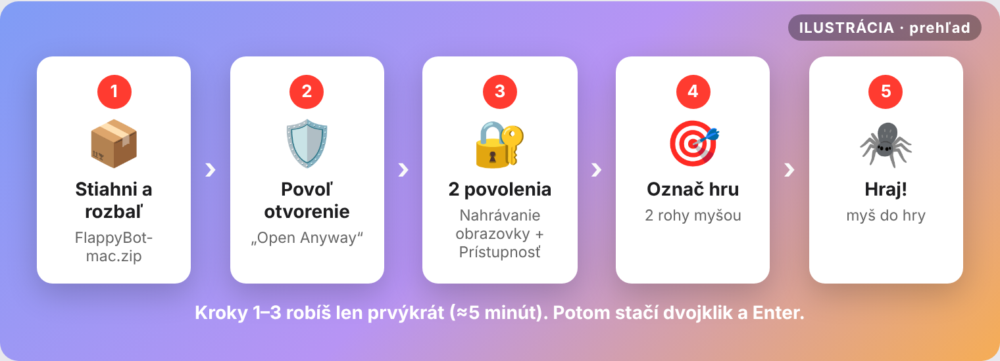

Kroky 1 – 3 robíš **len úplne prvýkrát** (cca 5 minút). Potom už len dvojklik,
Enter a hráš.

## Čo potrebuješ

- Mac s **macOS 12 alebo novším** (Apple Silicon M1/M2/M3/M4 aj Intel)
- **internet** pri prvom spustení (stiahnu sa potrebné súčasti, cca 100 MB)
- hru otvorenú v prehliadači (Safari, Chrome, …)

---

## Prvé spustenie krok za krokom

### Krok 1 – Stiahni a rozbaľ

1. Stiahni **[FlappyBot-mac.zip](https://github.com/Greejv/flappy-bird-bot/releases/latest/download/FlappyBot-mac.zip)**.
2. Otvor priečinok **Stiahnuté** (Downloads) a **dvakrát klikni na zip**.
   Vznikne priečinok **FlappyBot**.
3. Otvor priečinok **FlappyBot** a **dvakrát klikni na `Start Bot.command`**.

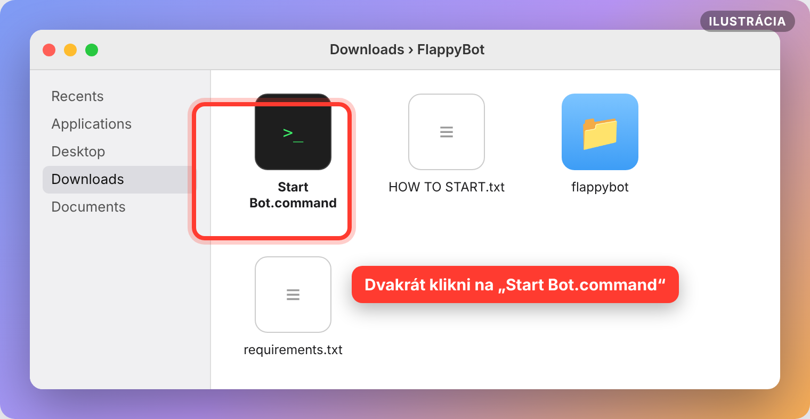

> 💡 Priečinok si môžeš presunúť kam chceš (napr. na Plochu). Len ho potom
> nepresúvaj počas behu bota.

### Krok 2 – Povoľ otvorenie (len prvýkrát)

macOS blokuje programy stiahnuté z internetu, ktoré nie sú z App Store. Je to
normálne. Takto to povolíš:

#### macOS 15 (Sequoia) a novší

**a)** Zobrazí sa varovanie *„Start Bot.command“ Not Opened* (v slovenčine
podobne: *nebol otvorený*). Klikni **Done** (*Hotovo*).
**Neklikaj** *Move to Trash* (*Presunúť do koša*)!

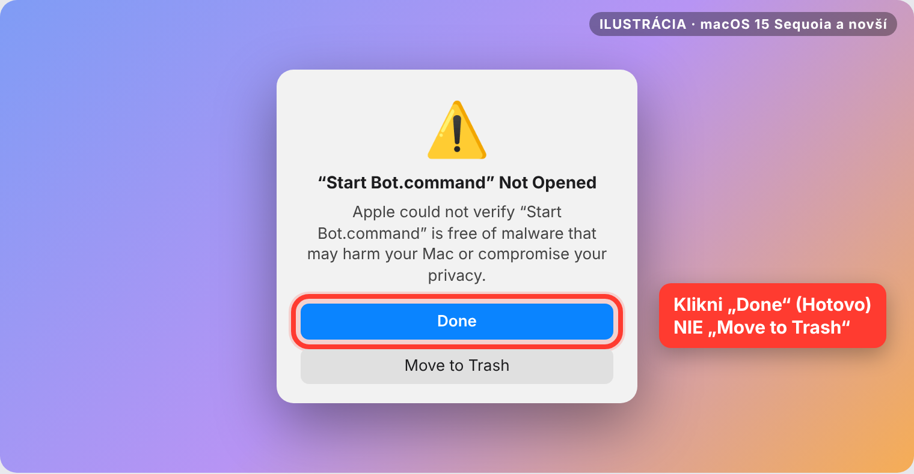

**b)** Otvor  **menu Apple → System Settings** (*Systémové nastavenia*) →
**Privacy & Security** (*Súkromie a bezpečnosť*). Zroluj **úplne dole** a pri
texte *„Start Bot.command“ was blocked…* klikni **Open Anyway**
(*Napriek tomu otvoriť*). Potvrď ešte raz a zadaj heslo k Macu alebo Touch ID.

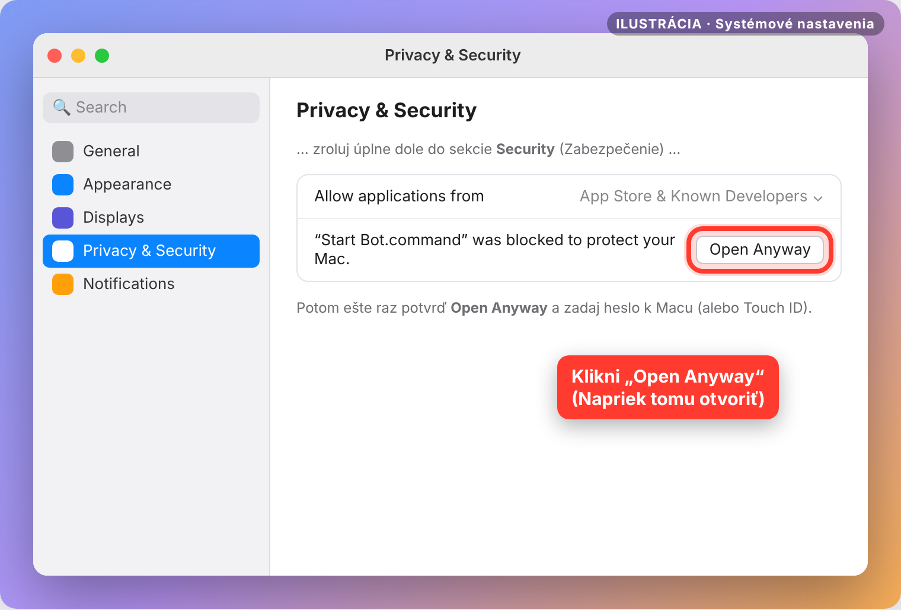

Potom znova dvakrát klikni na `Start Bot.command`.

#### macOS 14 (Sonoma) a starší

Klikni na `Start Bot.command` **pravým tlačidlom** (alebo Control + klik) →
**Open** (*Otvoriť*) → v okne znova **Open**.

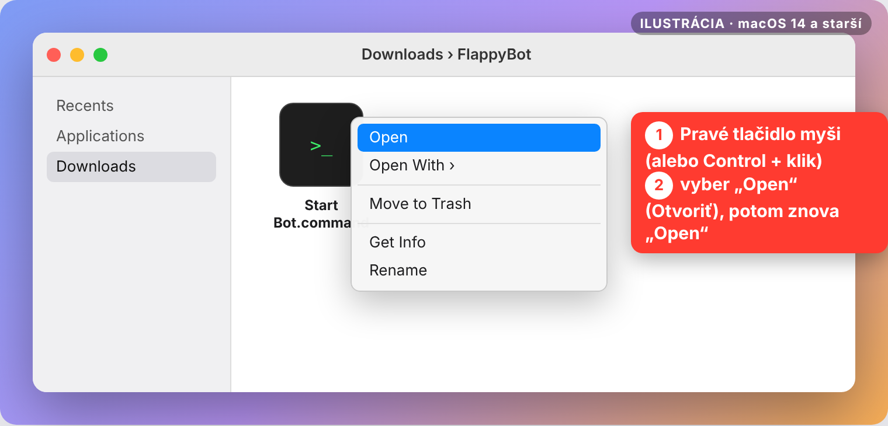

> ⚡ **Skratka pre každú verziu macOS:** otvor **Terminál** (⌘ + medzerník →
> napíš *Terminal* → Enter), vlož tento príkaz a stlač Enter. Odblokuje celý
> priečinok naraz:
> ```bash
> xattr -dr com.apple.quarantine ~/Downloads/FlappyBot
> ```

### Krok 3 – Prvé spustenie nainštaluje všetko samo (≈ 1 minúta)

Otvorí sa čierne okno **Terminálu** a bot sa pripraví. **Len počkaj**, nič
nestláčaj.

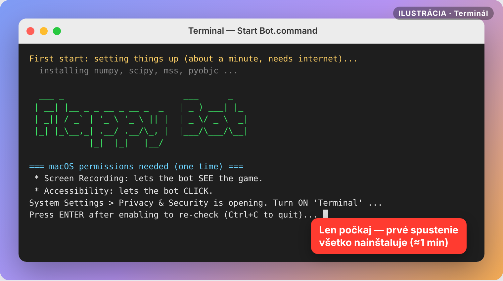

> 🧰 **Vyskočí okno „Command Line Developer Tools“?** To je Python od Apple.
> Klikni **Install** (*Inštalovať*), počkaj na dokončenie (pár minút) a potom
> znova dvakrát klikni na `Start Bot.command`.

### Krok 4 – Dve povolenia (len prvýkrát)

Bot potrebuje **vidieť** obrazovku a **klikať** myšou. Obe povolenia dávaš
aplikácii **Terminal** (*Terminál*), lebo bot beží v nej. Bot ti sám otvorí
správnu stránku nastavení.

#### 4a) Nahrávanie obrazovky – aby bot VIDEL hru

**System Settings → Privacy & Security → Screen & System Audio Recording**
(*Systémové nastavenia → Súkromie a bezpečnosť → Nahrávanie obrazovky a
systémového zvuku*; na macOS 14 a staršom len *Nahrávanie obrazovky*).
**Zapni prepínač pri Terminal.**

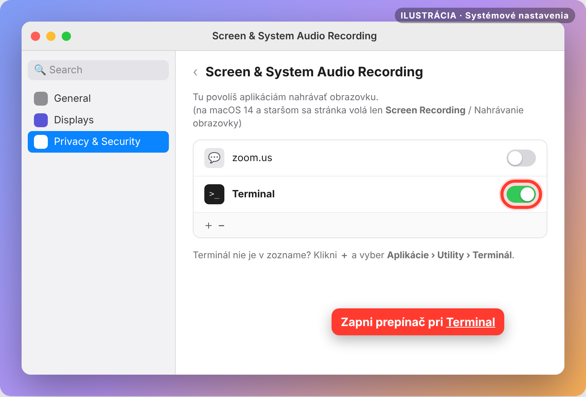

macOS sa spýta, či má Terminál reštartovať. Klikni **Quit & Reopen**
(*Ukončiť a znova otvoriť*). Prípadne Terminál zavri sám cez **⌘ + Q**.

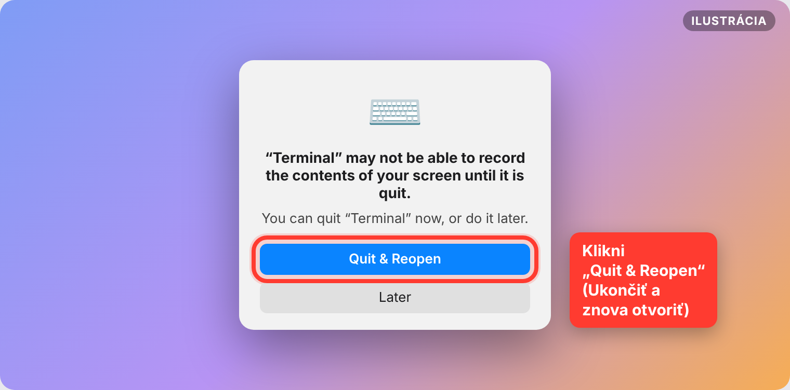

#### 4b) Prístupnosť – aby bot mohol KLIKAŤ

**System Settings → Privacy & Security → Accessibility**
(*Systémové nastavenia → Súkromie a bezpečnosť → Prístupnosť*).
**Zapni prepínač pri Terminal.** macOS si vypýta heslo, to je normálne.

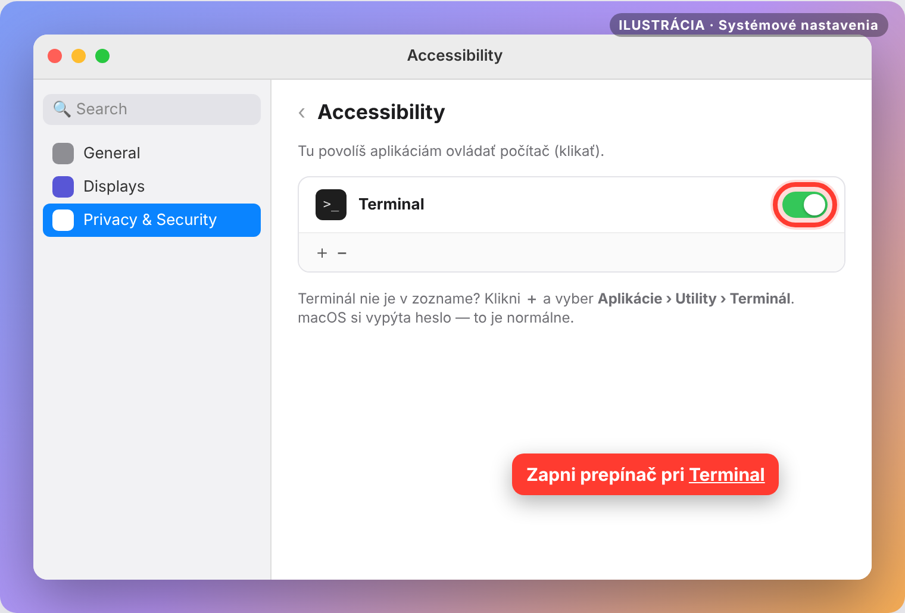

> ❓ **Terminál nie je v zozname?** Klikni **＋** pod zoznamom → choď do
> **Aplikácie → Utility** (*Applications → Utilities*) → vyber **Terminal** →
> **Otvoriť**.

✅ Hotovo. **Teraz znova dvakrát klikni na `Start Bot.command`.**

### Krok 5 – Ukáž botovi, kde je hra

1. Otvor hru v prehliadači tak, aby bola **celá viditeľná** (najlepšie
   maximalizuj okno prehliadača). Nič ju nesmie prekrývať.
2. V Termináli stlač **Enter**, keď sa to od teba pýta.
3. Daj myš na **ľavý horný roh hry** a nehýb ňou, kým neskončí odpočet (4 s).
4. Potom daj myš na **pravý dolný roh hry** a znova počkaj.

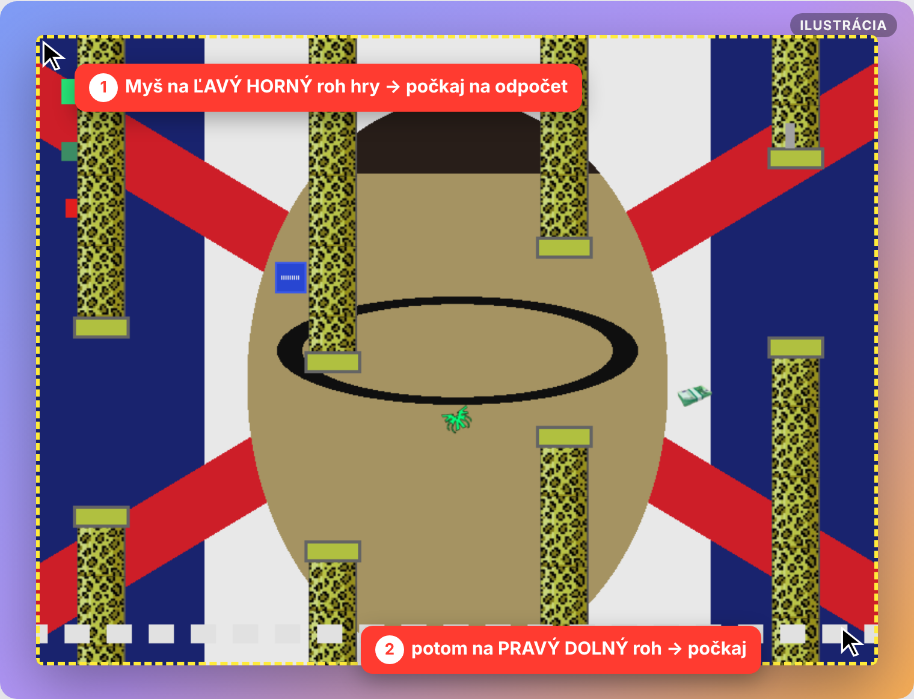

Bot si oblasť **zapamätá**. Hneď potom si urobí prvú snímku a vypíše, čo vidí,
napríklad `bird=YES pillars=4 money=1`. Ak vidíš `bird=no`, pozri
[Keď niečo nefunguje](#keď-niečo-nefunguje).

### Krok 6 – Hraj! 🎉

Presuň myš **do hry**. Bot začne klikať a hrať.

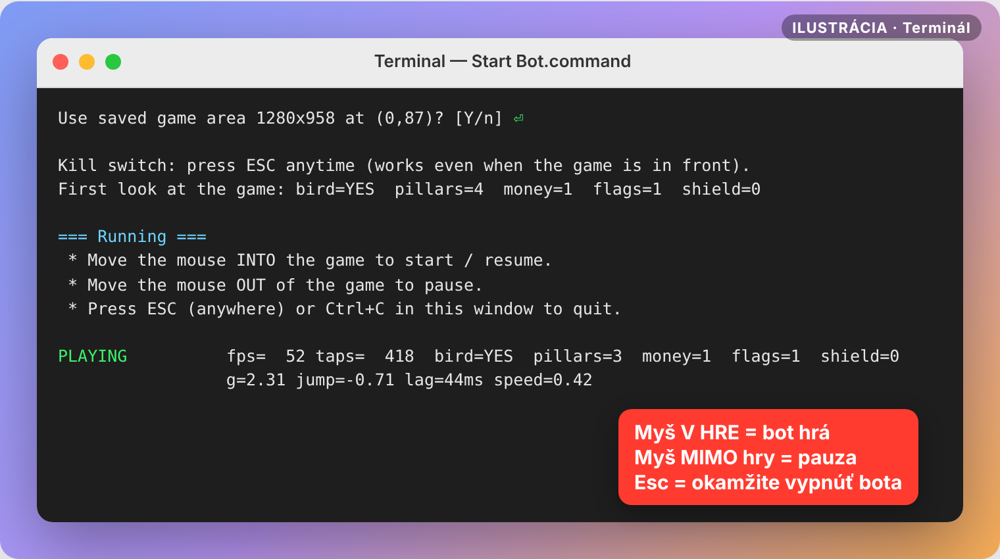

Prvých pár sekúnd vidíš v stavovom riadku **(learning)**. Bot si meria
gravitáciu, silu skoku a rýchlosť hry. Potom hrá naplno.

Čo znamená stavový riadok:

| Údaj | Význam |
|---|---|
| `PLAYING` / `PAUSED` / `waiting for bird` | hrá / pauza (myš mimo hry) / čaká, kým spustíš hru |
| `fps` | koľkokrát za sekundu sa bot pozrie na hru (viac = lepšie, ideálne 25+) |
| `taps` | koľkokrát už klikol |
| `bird / pillars / money / flags / shield` | čo práve vidí na obrazovke |
| `g / jump / lag / speed` | naučená fyzika hry (gravitácia, skok, oneskorenie, rýchlosť) |

---

## Ovládanie

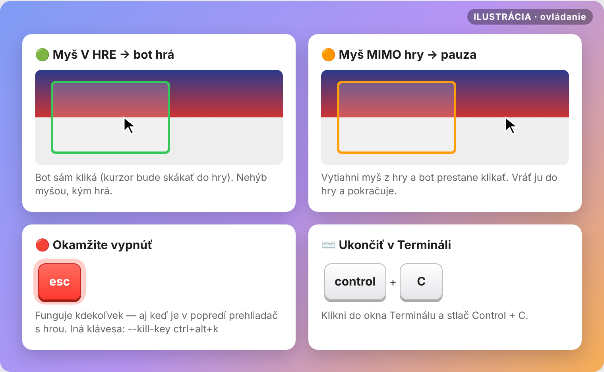

| Čo urobíš | Čo urobí bot |
|---|---|
| Myš **v hre** | 🟢 hrá (sám kliká, kurzor bude skákať do hry) |
| Myš **mimo hry** | 🟠 pauza, prestane klikať |
| **Esc** – kdekoľvek, aj keď je v popredí prehliadač | 🔴 **okamžite sa vypne** |
| **Control + C** v okne Terminálu | ukončí sa |

> 🖱️ Kým bot hrá, **nehýb myšou**. Bot ju potrebuje na klikanie. Keď chceš
> myš späť, vytiahni ju z hry (pauza) alebo stlač **Esc**.

---

## Keď hra skončí

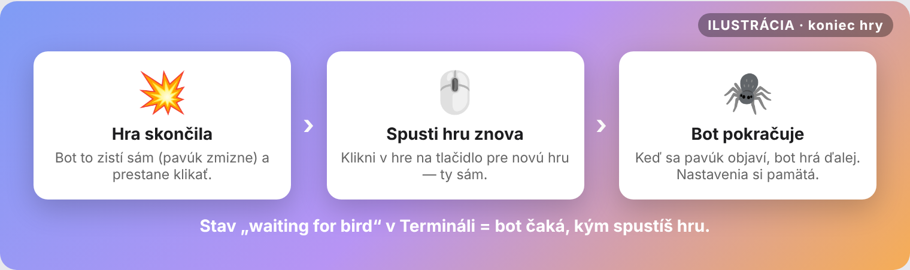

1. Keď pavúk narazí, bot to zistí sám a prestane klikať (`waiting for bird`).
2. **Novú hru spustíš ty**: klikni v hre na tlačidlo pre novú hru.
3. Keď sa pavúk znova objaví, bot hneď hrá ďalej. Všetko naučené si pamätá.

> 🛡️ **Modrý štít YOLO** ťa ochráni pred jedným nárazom (do stĺpa alebo
> vlajky). Bot ho preto rád zbiera.

---

## Ďalšie spustenia

1. Otvor hru v prehliadači (na rovnakom mieste ako minule).
2. Dvakrát klikni na `Start Bot.command`.
3. Na otázku *„Use saved game area?“* stlač **Enter**.
4. Myš do hry. Hotovo.

Ak si **posunul alebo zmenil veľkosť okna** prehliadača, napíš **n** a
Enter a označ hru znova (Krok 5).

---

## Nastavenia (pre pokročilých)

Bota môžeš spustiť aj z Terminálu s prepínačmi:

```bash
cd ~/Downloads/FlappyBot
./"Start Bot.command" --kill-key f12
```

| Prepínač | Čo robí |
|---|---|
| `--kill-key ctrl+alt+k` | iná klávesa na okamžité vypnutie (predvolená `esc`; napr. `f12`, `cmd+shift+x`) |
| `--reselect` | znova označiť oblasť hry |
| `--test` | urobí 1 snímku, uloží `debug/check.png` (čo bot vidí) a skončí |
| `--debug` | počas hry ukladá obrázky do priečinka `debug/` |
| `--flag-weight 20` | ešte viac sa vyhýbať vlajkám (predvolené 10) |
| `--money-weight 2` | viac sa naháňať za peniazmi (predvolené 1) |
| `--shield-weight 3` | viac sa naháňať za štítom YOLO (predvolené 2) |

---

## Keď niečo nefunguje

| Čo vidíš | Riešenie |
|---|---|
| Okno sa hneď zavrie / „cannot be opened“ | Krok 2 – povoľ otvorenie. |
| `bird=no` stále, alebo snímka je čierna | Chýba **Nahrávanie obrazovky** pre Terminál (Krok 4a). Zapni ho, **ukonči Terminál (⌘ + Q)** a spusti znova. |
| Bot vidí hru, ale neklikne | Chýba **Prístupnosť** pre Terminál (Krok 4b). Zapni, ukonči Terminál, spusti znova. |
| Kliká mimo hry | Okno sa posunulo. Spusti znova a na *„Use saved game area?“* napíš **n**. |
| Esc nefunguje | Použi **Control + C** v Termináli. Prípadne skús inú klávesu: `--kill-key f12`. |
| Nízke `fps` (pod 15) | Zmenši okno prehliadača a zavri iné náročné karty a programy. |
| Inštalácia zlyhá | Skontroluj internet a spusti znova. Pomôže aj nainštalovať Python z [python.org](https://www.python.org/downloads/macos/). |
| macOS sa po pár týždňoch znova pýta na nahrávanie obrazovky | Normálne na macOS 15+. Klikni **Allow** (*Povoliť*). |

### Pozri sa, čo bot vidí

```bash
cd ~/Downloads/FlappyBot
./"Start Bot.command" --test
```

Uloží sa obrázok **debug/check.png**. Každý objekt v hre by mal mať rámik:

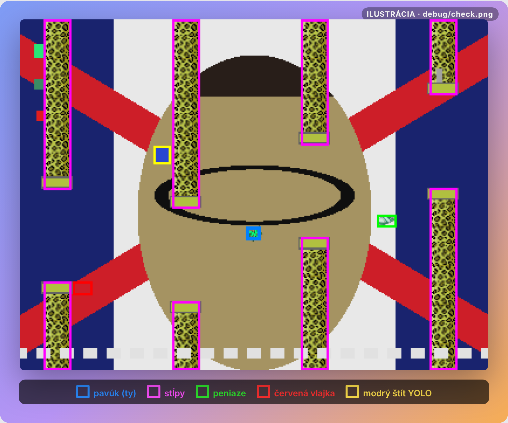

🟦 pavúk · 🟪 stĺpy · 🟩 peniaze · 🟥 červené vlajky · 🟨 modrý štít YOLO.
Stĺpy a peniaze v hre menia farby (dúha) a bot s tým počíta.

> 📨 Ak niečo nemá rámik, pošli mi `debug/check.png` a opravím to.

---

## Časté otázky a odinštalovanie

**Prečo povolenia pre Terminál?** Bot je program v jazyku Python a beží v
Termináli. macOS preto povolenia priraďuje Terminálu.

**Je to bezpečné?** Bot len robí snímky zvolenej časti obrazovky a kliká do
hry. Nič neposiela na internet (okrem stiahnutia súčastí pri prvom spustení).
Zdrojový kód je celý na [GitHube](https://github.com/Greejv/flappy-bird-bot).

**Ako to celé odinštalovať?**
1. Vymaž priečinok **FlappyBot**.
2. Vymaž skryté súbory bota (v Termináli):
   ```bash
   rm -rf ~/.flappybot-venv ~/.flappybot.json
   ```
3. Ak chceš, vypni Terminálu povolenia v *Súkromie a bezpečnosť →
   Nahrávanie obrazovky* a *Prístupnosť*.
