# 📖 Install & run Flappy Money Bot on your Mac (step by step)

About **5 minutes** the first time. After that it's just a double-click.

> The pictures are **illustrations**. Your Mac looks very similar but may differ
> slightly depending on your macOS version.

**You need:** a Mac (Apple Silicon or Intel, macOS 12 or newer), an internet
connection for the first start, and the game open in your browser.

---

## Step 1: Download and unzip

1. Download **[FlappyBot-mac.zip](https://github.com/Greejv/flappy-bird-bot/releases/latest/download/FlappyBot-mac.zip)**.
2. Open your **Downloads** folder and **double-click the zip**. You get a folder called **FlappyBot**.
3. Open the **FlappyBot** folder and **double-click `Start Bot.command`**.

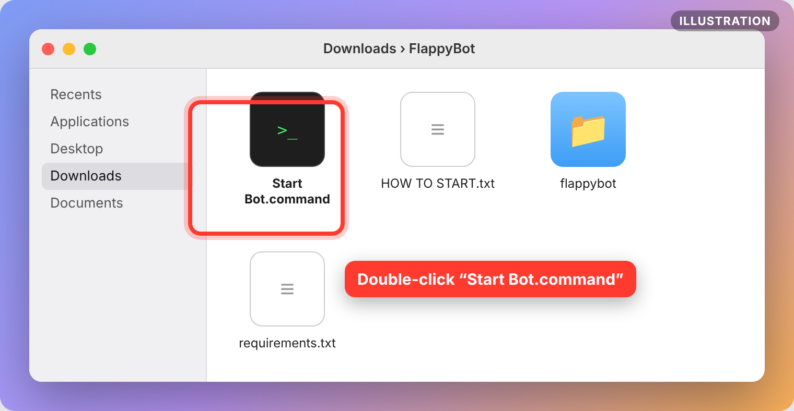

---

## Step 2: Let macOS open it (one time)

macOS blocks files downloaded from the internet that aren't from the App
Store. That's normal. Here's how to allow it.

### macOS 15 (Sequoia) and newer

**a)** A warning appears. Click **Done**. Do **not** click *Move to Trash*.

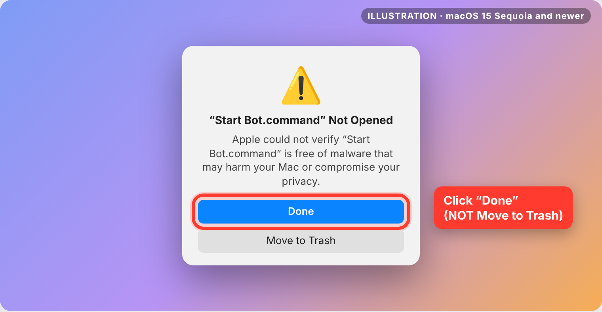

**b)** Open  **Apple menu → System Settings → Privacy & Security**, scroll
**all the way down**, and click **Open Anyway** next to *"Start Bot.command" was
blocked*. Confirm with **Open Anyway** again and your password or Touch ID.

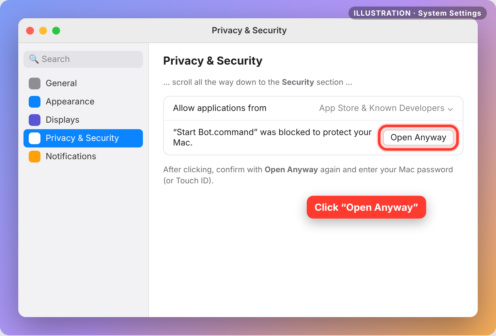

### macOS 14 (Sonoma) and older

**Right-click** (or Control-click) `Start Bot.command` → **Open** → **Open**.

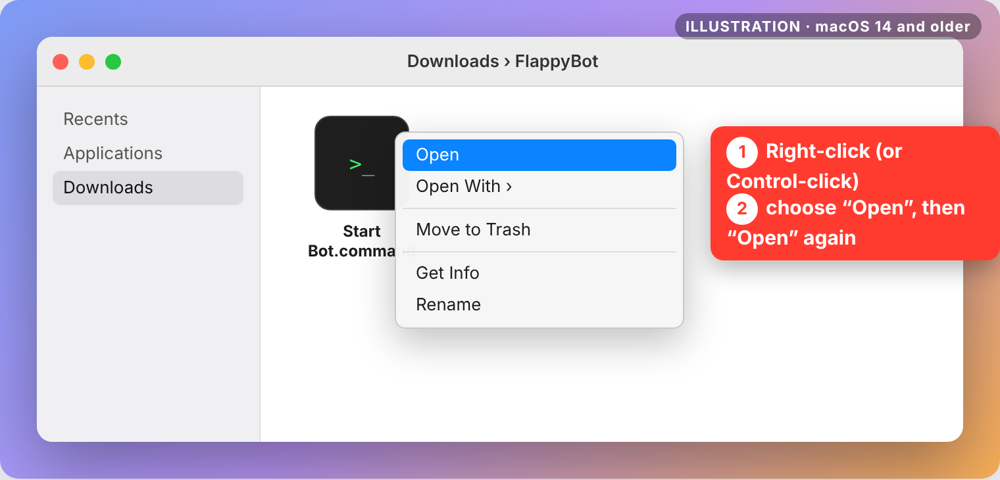

> **Shortcut for any macOS version:** open **Terminal** (⌘ Space → type
> *Terminal* → Enter), paste this and press Enter. It removes the block from
> the whole folder:
> ```bash
> xattr -dr com.apple.quarantine ~/Downloads/FlappyBot
> ```

---

## Step 3: First start installs everything (≈1 minute)

A black **Terminal** window opens and sets itself up. Just wait.

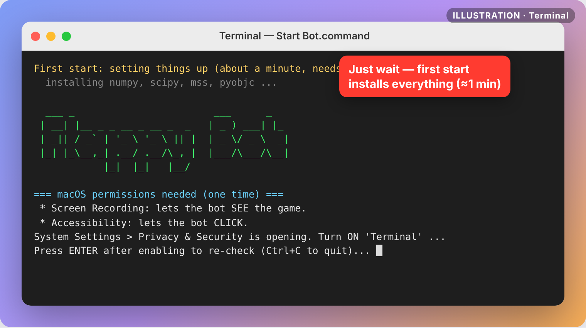

> **"Command Line Developer Tools" popup?** That's Apple's Python. Click
> **Install**, wait until it's done, then double-click `Start Bot.command` again.

---

## Step 4: Allow the two permissions (one time)

The bot needs to **see** the screen and **click** the mouse. macOS asks you
to allow both for the app **Terminal** (the bot runs inside Terminal).
The bot opens the right settings pages for you.

### 4a. Screen Recording, so the bot can *see* the game

**System Settings → Privacy & Security → Screen & System Audio Recording**
(called **Screen Recording** on macOS 14 and older). Switch **Terminal** **ON**.

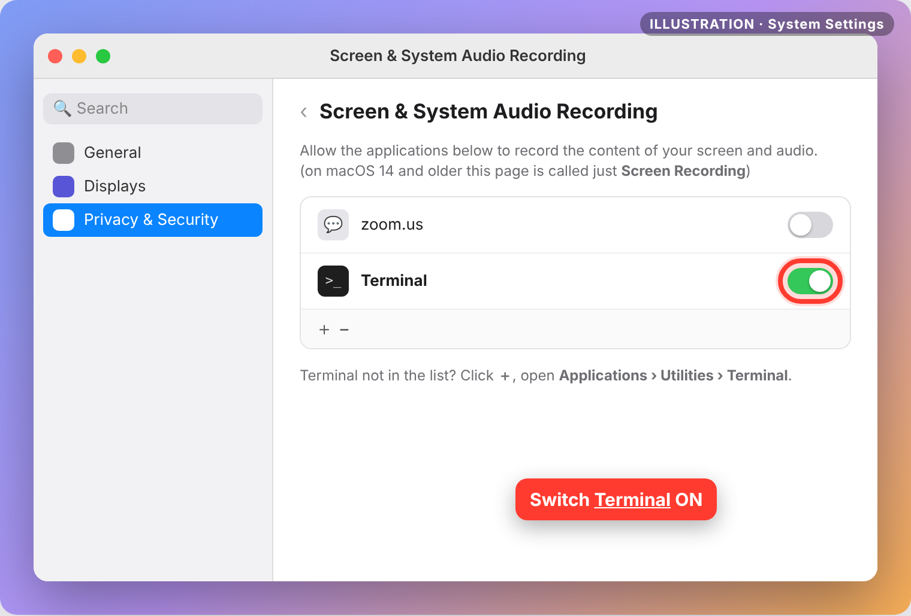

macOS then asks to quit Terminal. Click **Quit & Reopen** (or quit Terminal
with **⌘Q** yourself).

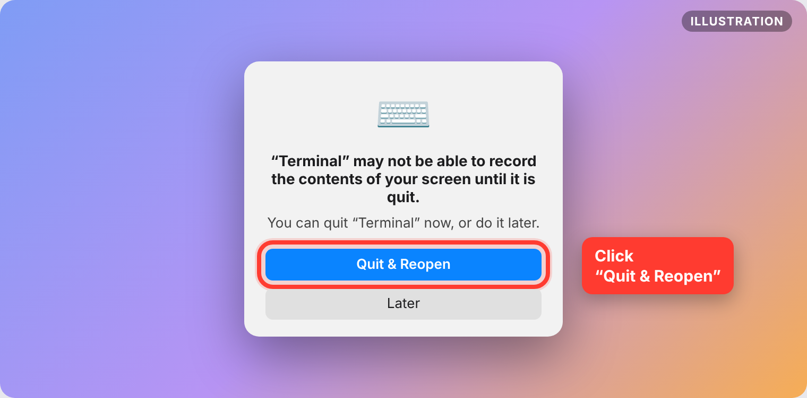

### 4b. Accessibility, so the bot can *click*

**System Settings → Privacy & Security → Accessibility**. Switch **Terminal**
**ON**. macOS asks for your password; that's normal.

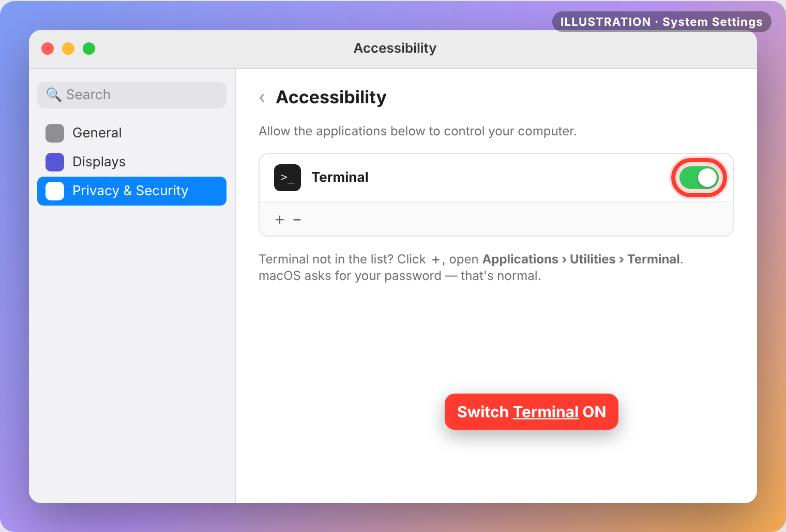

> **Terminal isn't in the list?** Click the **＋** under the list, go to
> **Applications → Utilities**, choose **Terminal** and click **Open**.

**Now double-click `Start Bot.command` again.**

---

## Step 5: Show the bot where the game is

1. Make the game fully visible (best: maximise the browser window).
2. Press **Enter** in Terminal when asked.
3. Put the mouse on the **top-left corner** of the game and keep it still
   until the countdown ends.
4. Then put it on the **bottom-right corner** and wait again.

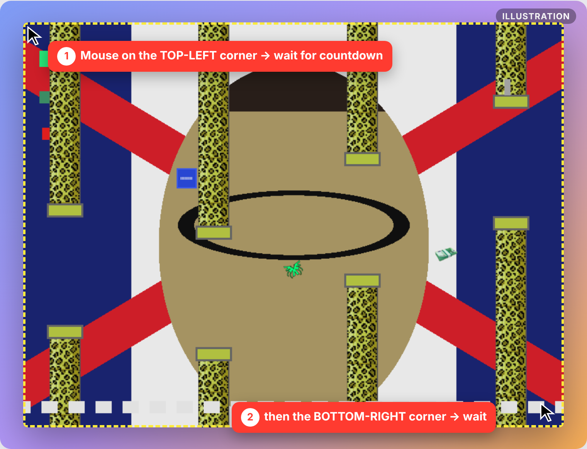

The bot remembers this. Next time, just press **Enter** at *"Use saved game
area?"*. If you moved or resized the browser, type **n** and select again.

---

## Step 6: Play! 🎉

| You do | The bot does |
|---|---|
| Move the mouse **into** the game | plays |
| Move the mouse **out of** the game | pauses |
| Press **Ctrl + C** in Terminal | quits |

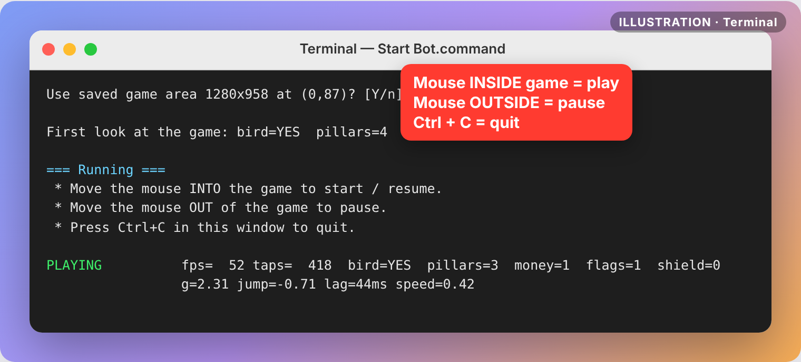

The first few seconds the status line shows **(learning)**. The bot is
measuring the game's gravity, jump and speed. After that it plays at full skill:
it flies through the gaps, collects 💶 money, grabs the 🟦 **YOLO shield**
and avoids 🚩 red flags.

---

## Something not working?

| What you see | Fix |
|---|---|
| Capture is black / `bird=no` all the time | Screen Recording is not on for **Terminal** (Step 4a). Turn it on, **quit Terminal (⌘Q)**, start again. |
| Bot sees the game but nothing happens | Accessibility is not on for **Terminal** (Step 4b). Turn it on, quit Terminal, start again. |
| It clicks in the wrong place | The window moved. Start again and answer **n** to *Use saved game area?* |
| macOS asks again about screen recording after some weeks | Normal on macOS 15+. Click **Allow**. |
| Anything else | Run it from Terminal with `--test` (below) and look at `debug/check.png`. |

### See what the bot sees

```bash
cd ~/Downloads/FlappyBot
./"Start Bot.command" --test
```

This saves **debug/check.png** in the FlappyBot folder. Every object should
have a box:

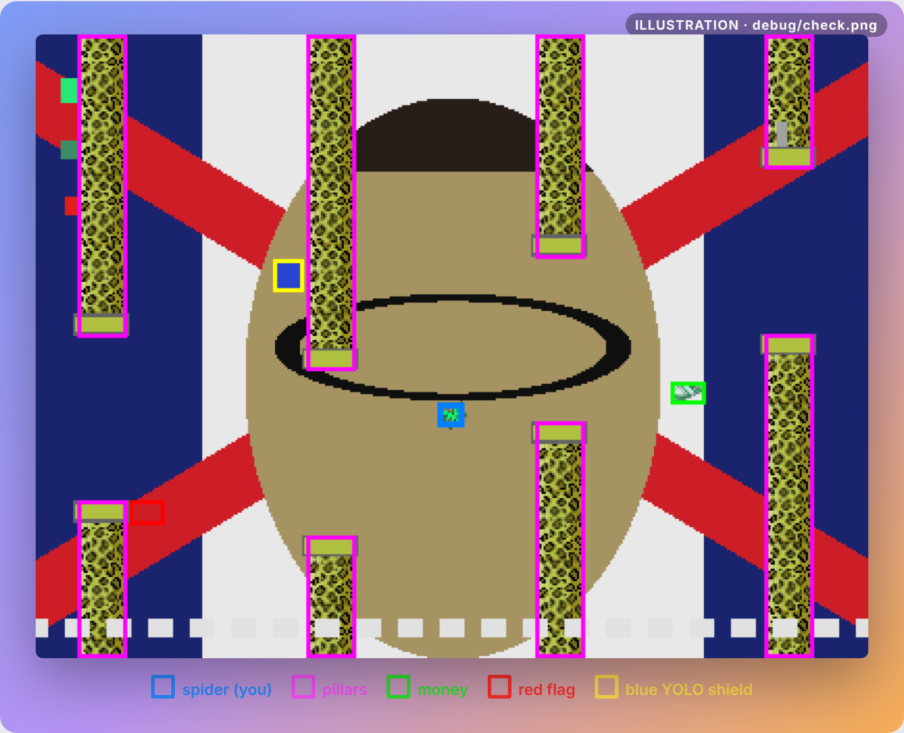

Blue = spider (you), magenta = pillars, green = money, red = red flags,
yellow = blue YOLO shield. The pillars and money change colour (rainbow) in
the game; the bot handles that.
